# Steam Authenticator

A lean desktop Steam Guard authenticator for Windows. Plain maFiles next to the exe, confirmations, no background hammering of Steam.

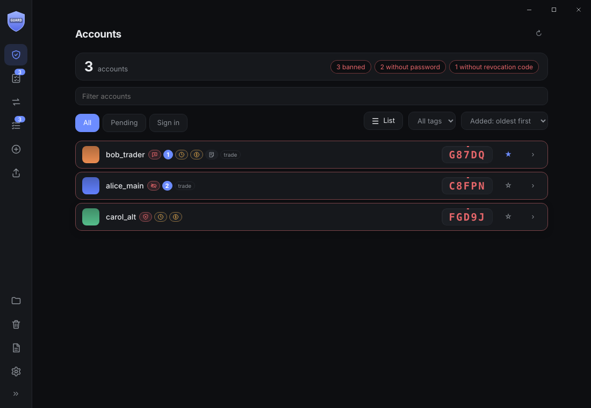

<table>
<tr>
<td width="50%">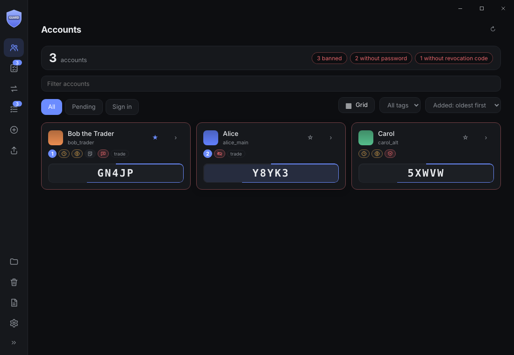<br><sub>List, compact list, columns or grid layout, with an icon per ban type</sub></td>
<td width="50%">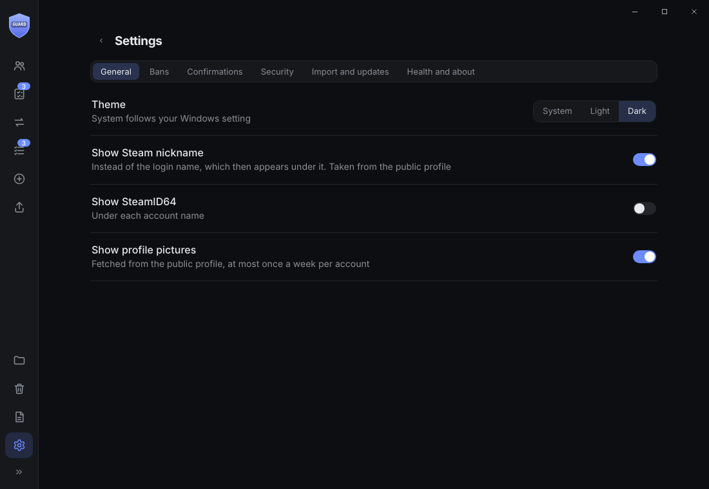<br><sub>Settings in tabs: theme, bans and API key, security, import</sub></td>
</tr>
<tr>
<td width="50%">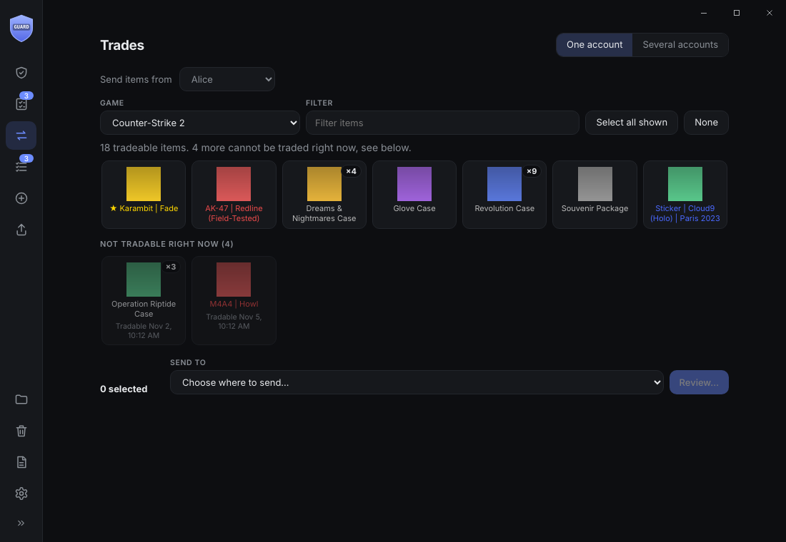<br><sub>Trades tab: send tradeable items to another account or a trade link</sub></td>
<td width="50%">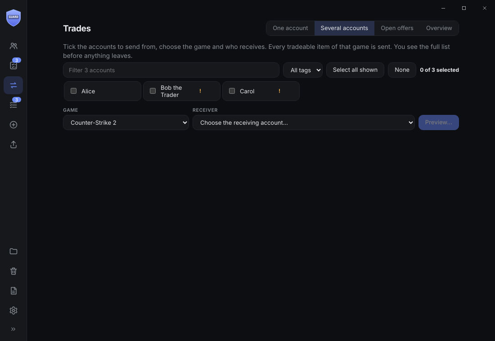<br><sub>Bulk: several accounts to one, with a preview before anything is sent</sub></td>
</tr>
<tr>
<td width="50%">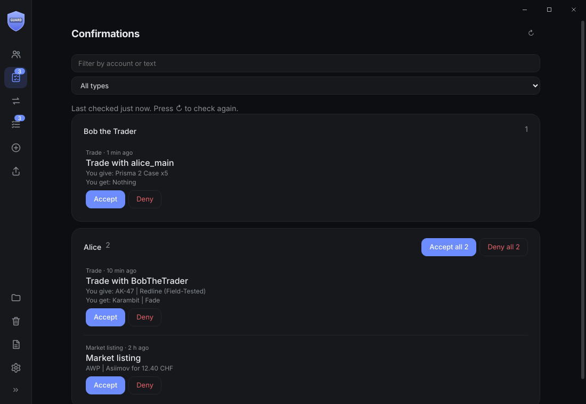<br><sub>Confirmations across all accounts, grouped and filterable</sub></td>
<td width="50%">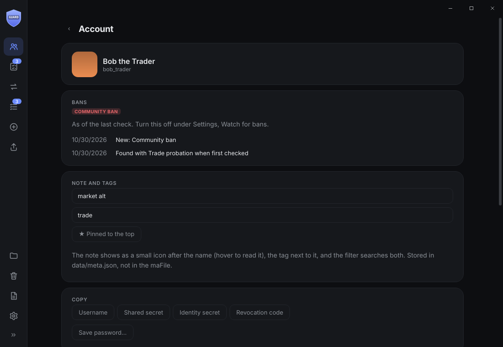<br><sub>Account page: copy fields, open Steam signed in</sub></td>
</tr>
<tr>
<td width="50%">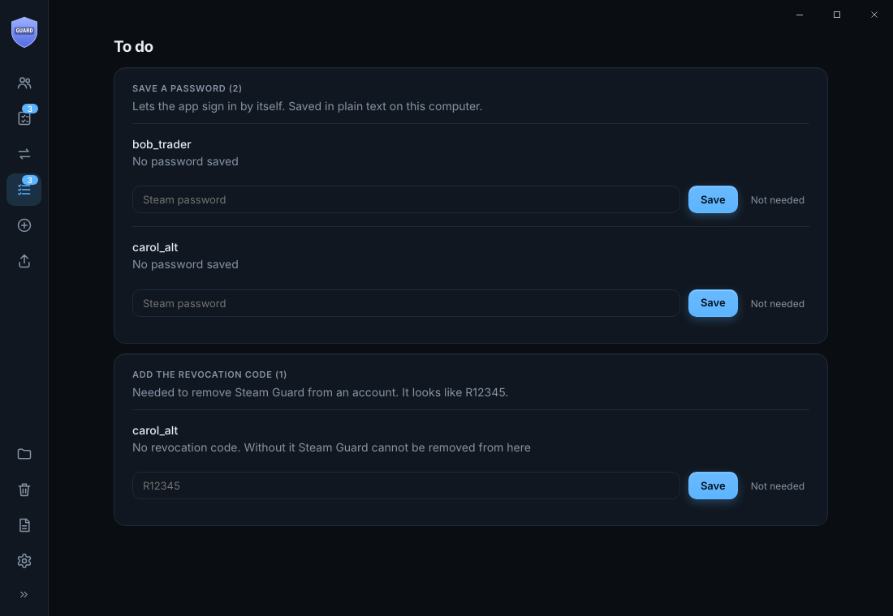<br><sub>To do: what is missing per account</sub></td>
<td width="50%">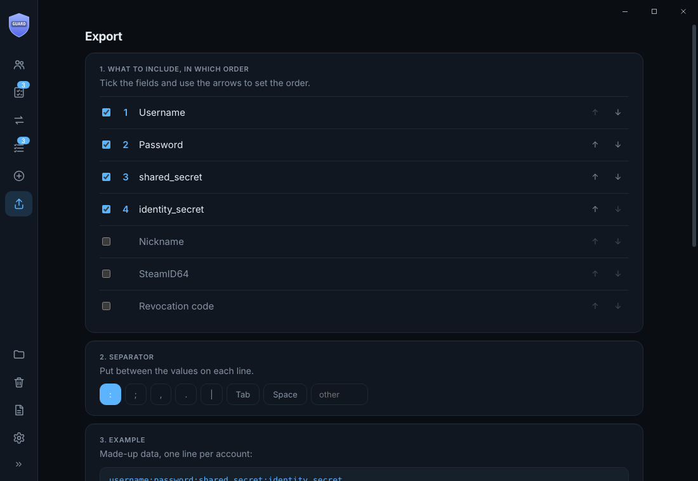<br><sub>Export with your own fields and separator</sub></td>
</tr>
<tr>
<td width="50%">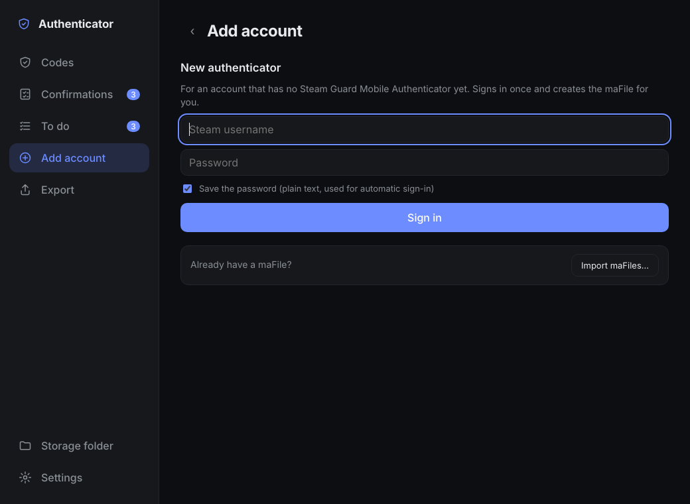<br><sub>Add an authenticator to an account that has none</sub></td>
<td width="50%">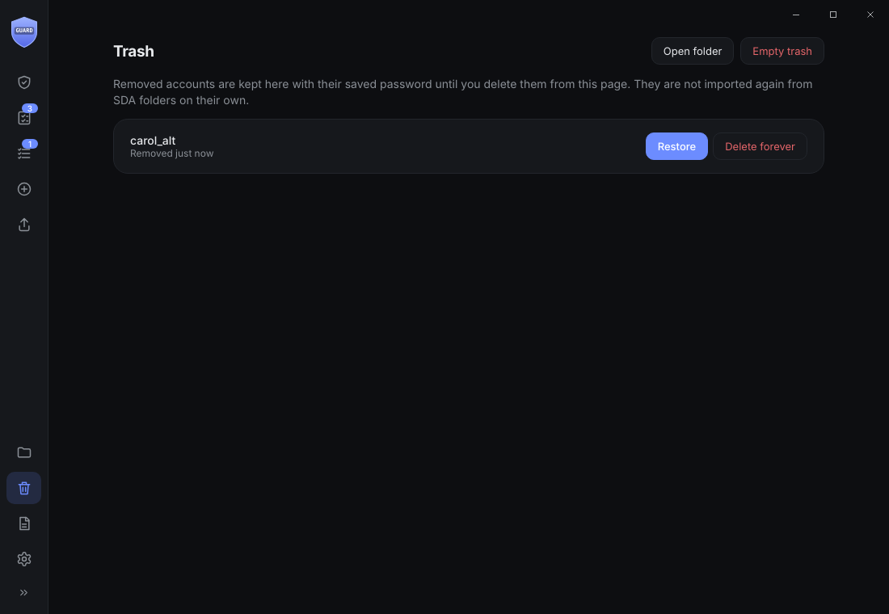<br><sub>Removed accounts wait in the Trash and can be restored</sub></td>
</tr>
<tr>
<td width="50%">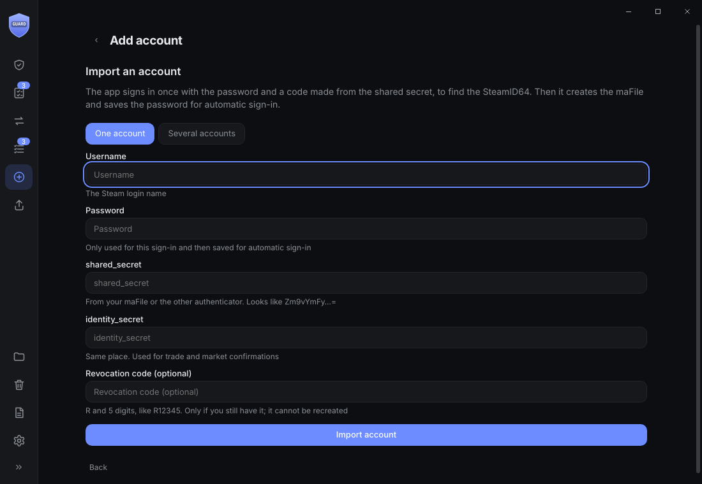<br><sub>Import an account from its username, password and secrets (one or many)</sub></td>
<td width="50%">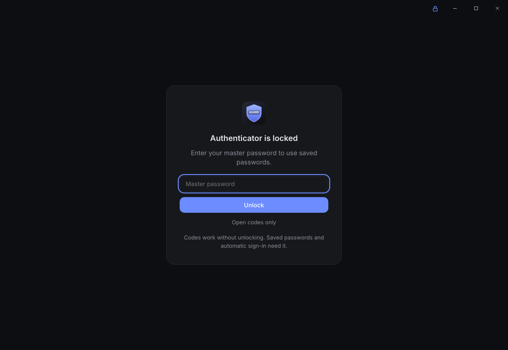<br><sub>Optional master password and per-PC PIN for saved passwords</sub></td>
</tr>
<tr>
<td width="50%">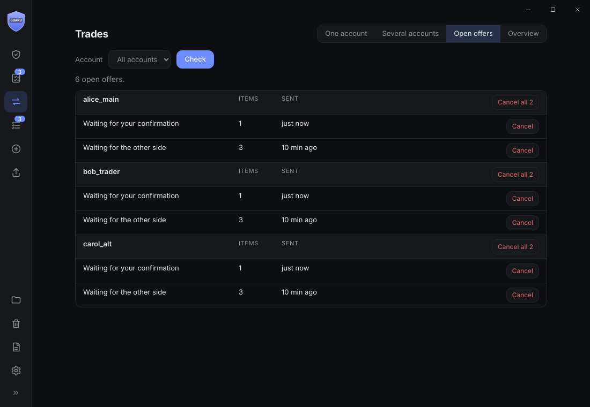<br><sub>Open offers: see and cancel what nobody accepted yet</sub></td>
<td width="50%">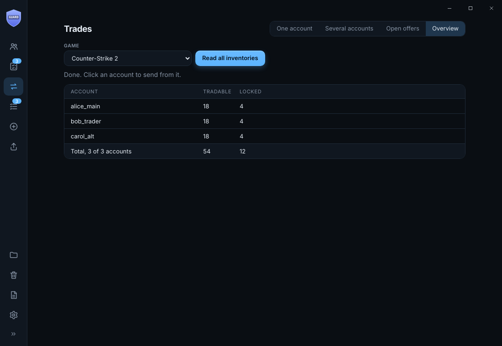<br><sub>Overview: tradable and locked items of every account</sub></td>
</tr>
</table>

*Screenshots use made-up accounts.*

Minimal desktop Steam Guard authenticator (Electron + TypeScript, no UI framework).

- **Accounts and codes** with Steam clock sync, the time left shown as a ring around the code box. Click the code box to copy (clipboard clears after a configurable time). Click an account name to open its Steam profile.
- **Drop folder:** put maFiles (any file name) into the storage folder while the app is running or closed;
  they are renamed to `<steamid>.maFile` and appear within a second or two. "Open storage folder" shows it
  (the `maFiles` folder next to the exe in the Windows build).
- **Auto-import:** on start, folders named `maFiles` in Downloads, Desktop and Documents (plus any folders
  you add in Settings) are scanned. New accounts are copied as plain `.maFile` files into the app's
  `maFiles` folder. Existing accounts are never overwritten and originals are never changed.
- **Confirmations:** pending trades/market listings per account, review, accept or deny selected,
  accept/deny all. Security-related requests (account recovery, phone change) are never included in
  "all" and must be handled one at a time.
- **Sign-in:** needed only if the maFile has no usable session. The Steam Guard code is generated
  from the shared secret. You can save a password per account (`credentials.json`, plain text). It is checked with a real sign-in when you save it (a wrong one is refused), then used automatically. A rejected saved password is not retried for 30 minutes (or until you change it).
  A refresh token is kept in `sessions.json` (plain text).
- **Copy** username, password (if saved), shared secret, identity secret, revocation code, SteamID64.
- **Profile pictures** from the public profile (no API key), at most once a week per account.
- **Trades tab, check:** one button tells whether an account can trade right now (session, trade link, bans).
- **Trades tab, open offers:** see offers that nobody accepted yet, per account or all at once, and cancel them.
- **Trades tab, overview:** how many tradable and locked items every account holds in a game, with a total.
- **Backup:** one encrypted file with all maFiles, saved passwords, notes and tags (Settings, Import and updates). Restoring only adds missing accounts.
- **Trades tab, bulk:** tick several accounts and a game, preview what each would send, then send everything to one account.
- **Trades tab:** pick an account's tradeable items (with pictures) and send them to another of your accounts or a trade link in one go; offers are split, checked against the live inventory and confirmed for you.
- **Settings:** in tabs: theme (system, light or dark), nickname, SteamID64, pictures, ban watching and the optional API key, check on startup / optional interval, clipboard clearing, master password and PIN, updates, import folders, health check.

    npm install      (PowerShell: npm.cmd install)
    npm test
    npm start        (PowerShell: npm.cmd start)
    npm run package:win   builds out/Authenticator-portable (no Node needed to run it)

Code generation is checked against steam-totp for parity (`npm test`).

## Adding an authenticator to an account that has none

`+` > Add account. Sign in with username and password (plus the emailed code if Steam asks), confirm, and the app asks Steam to attach a Mobile Authenticator. The new secrets and the revocation code are written to `pending/` *before* activation, so a crash or lost connection cannot lose them. After you enter the SMS/email activation code, the maFile moves into the storage folder and the account appears in the list. "Cancel and remove it again" detaches it using the revocation code.

Needs the account to have a confirmed phone number or email. Write the revocation code down.

Click an account name to open its Steam profile; click the code box to copy the code.

## When it talks to Steam

Confirmations are checked once at startup (can be turned off in Settings) and whenever you press the refresh button. There is no background polling unless you pick an interval. A round checks one account at a time with a pause between them, ignores repeated button presses for 20 seconds, and stops completely for 10 to 30 minutes if Steam says to slow down.

## Open on Steam, signed in

On an account's page, Profile / Inventory / Trade offers / Market / Store / Account open a separate window already logged in as that account (using its saved session; it signs in with the saved password first if needed). Each window has its own in-memory session that is wiped on close, can only stay on Steam domains, and sends other links to your normal browser.

## Folder layout (Windows build)

```
Authenticator.exe   small launcher, double-click this
app/                the program itself
maFiles/            your maFiles, like SDA (created on first start)
data/               settings, saved passwords, caches (created on first start)
```
Everything lives next to the exe, so copying or backing up the folder moves it all. If the folder is not writable (for example inside Program Files) the per-user app data folder is used instead. On first start, data from the earlier per-user location is copied over (the old copy is left in place).

**Updating:** download the new release, drag the new folder over the old one and choose "Replace the files in the destination". The release contains no `maFiles` or `data` folder, so your accounts and settings are never touched, and the app recreates anything missing by itself. Close the app first.

The launcher is built from `launcher/launcher.c` (a prebuilt `launcher/Launcher.exe` is included).

## To do and Export

To do lists what is missing per account (saved password, revocation code, sign-in, unfinished activation) with the fix inline. Export builds a plain-text list: pick fields and their order, pick the separator (`: ; , . |`, tab, space or your own), see an example with made-up data, then copy or save as .txt.

## Security

The maFiles stay plain on purpose (SDA format, easy to back up). What can be protected is everything else that unlocks an account:

- **Master password** (Settings > Security): encrypts `credentials.json`, `sessions.json` and the saved passwords of trashed accounts with AES-256-GCM. The key is random and stored wrapped by a key derived from your password (scrypt), so changing the password does not re-encrypt anything. Nothing ties it to a PC, so the folder stays portable (for example on a synced drive). Forgetting the password means saved passwords and sign-in tokens are gone; the maFiles are not affected. Turning it off writes the files back as plain text.
- **Locked mode:** the app asks for the password when it starts. "Open codes only" skips it: codes work, saved passwords and automatic sign-in stay locked and nothing in the encrypted files can be overwritten.
- **PIN on this PC:** a 4 to 12 digit PIN unlocks without the master password. Its key file lives in `%LOCALAPPDATA%\AuthenticatorDevice`, **not** in the program folder, so a copy of the folder on another PC or in the cloud has no PIN. Five wrong tries delete it. It is a convenience for a PC you trust, not a strong barrier against someone who can read your user files (they can try PINs offline), so use 6 or more digits and disk encryption such as BitLocker.
- Not covered: malware running as you while the app is unlocked, and the maFiles themselves.

## Trash

Removing an account moves its maFile (and its saved password) to `data/trash/` instead of deleting it. The Trash page in the sidebar lists them with Restore and Delete forever, plus Empty trash and Open folder. Restoring puts the account and its password back. A removed account is not re-imported on its own from SDA folders; Restore it, or import its file by hand.

## Window

The window draws its own title bar (minimize, maximize, close) in the app's colours, remembers its size and position (`data/window.json`), and only one copy runs per folder. Ctrl+F jumps to the filter box. Nothing refreshes while the window is minimized.

## Log

The Log page shows warnings and errors with full details for troubleshooting (also saved in `data/log.jsonl`). Secrets, passwords, tokens and revocation codes are redacted before they are stored, so a log can be shared safely.

---

© 2026 github.com/AnotherAsianDev. Released under the [MIT License](LICENSE). Not affiliated with or endorsed by Valve; Steam is a trademark of Valve Corporation.
